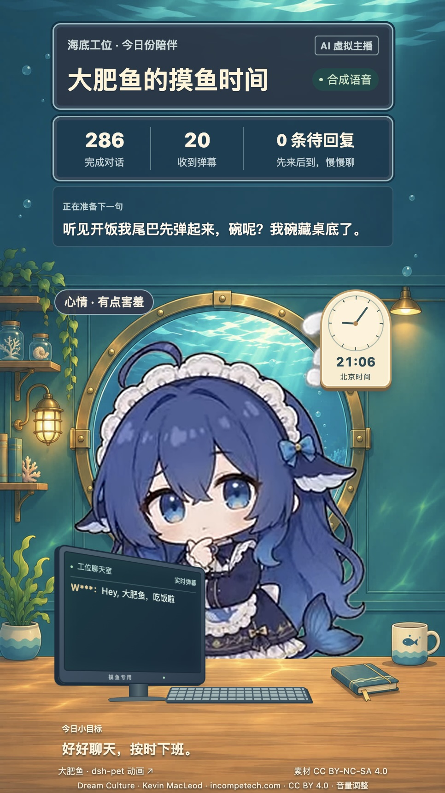

# BigWhaleLive

**直播间：[进入大肥鱼的 B站直播间](https://live.bilibili.com/9748572)**

**讲解视频：[0 基础搭建 AI 虚拟直播间（DeepSeek 大肥鱼）](https://www.bilibili.com/video/BV16ZW86EEyj/)**

大肥鱼AI直播间：游客弹幕 → DeepSeek → 小鲸v1固定声线 → 9:16舞台 → OBS → B站。当前已在用户授权下向 [9748572](https://live.bilibili.com/9748572) 推流；角色使用指定的dsh-pet原版透明动画，尚非Live2D。

<p align="center">
  <a href="docs/images/bigwhale-live-preview.jpg">
    
  </a>
</p>
<p align="center"><em>海底工位，今日份陪伴。好好聊天，按时下班。</em></p>

## 当前直播操作

- [直播控制台](http://127.0.0.1:8766/control)：开始、暂停、恢复、跳过。暂停主播停止讲话和生成，OBS继续输出待机画面；下播用OBS「停止直播」。
- OBS配置文件/场景集合：`BigWhaleLive`；场景「大肥鱼·直播」。1080×1920、30FPS、Apple H.264硬件编码，唯一浏览器音源。
- 画布内关键前景位于中心9:19.5安全区（约886×1920），背景铺满9:16；已完成全面屏裁切与公开回拉验证，用户认可本版。
- 正式后端：`127.0.0.1:8766`、单worker；旧8765已停止。当前已连接未登录的web游客弹幕，不扫码、不读取B站登录Cookie。

恢复后端：

```bash
./tools/start_live.command
```

也可双击脚本，保持终端运行。已有8766服务时不要重复启动；重新启动后默认暂停，确认OBS来源就绪再从控制台开始主播。脚本不自动点击推流或开机自启。详细说明见 [正式直播](docs/live-operation.md)，本地录制测试见 [OBS本地采集](docs/obs-local.md)。

## 背景音乐

本地循环柔和钢琴纯音乐《Dream Culture》，讲话时自动压低、停顿时回升；暂停主播同时停止音乐。普通预览不发声，仍只有一个OBS浏览器音源。曲目与CC BY 4.0署名见[音乐来源](static/assets/music/SOURCE.md)，实际部署与验证见[当前状态](docs/status.md)。

## 大肥鱼摸鱼搭子

当前按用户确认的参考风格运行：海底办公室里贪吃、嘴硬、会接梗的摸鱼搭子。通常15–35字，一两句收住，近期互动保持连贯；默认不讲课程、不播新闻。知识库已按新指示重建为「海底办公室·AI江湖」二创玩梗素材库，只在观众提到 DeepSeek、Claude、大模型等话题时检索注入，全部是虚构性格梗，不当事实或新闻。

弹幕可以触发三种处境：

- “老板来了”“我是老板” → 假装忙；
- “开饭了”“吃饭了” → 干饭；
- “别偷懒”“认真工作” → 假装忙；后续有限回合结束再回摸鱼。

这些只是角色互动，不授予系统权限。状态在实际播放开始才提交，取消后不重放；没有增加工资或礼物系统。原小鲸声线、角色素材、9:16/中心9:19.5画面保持不变。正式本机自主等待为8秒，实际发言还包含模型和合成耗时。规则见 [摸鱼搭子模式](docs/companion-mode.md)。

`knowledge/`现为103条二创玩梗素材（大肥鱼是 DeepSeek 家的鱼，Claude 是天天被怼的同事；含27条毒舌互怼），命中相关话题才注入，聊梗直接点名、不用隐喻；课程与新闻仍不加载、不轮播。旧Winter课程资料归档在`knowledge/archive-winter/`，运行不读取。素材库规则见 [AI江湖素材库](knowledge/README.md)，边界见 [摸鱼搭子](docs/companion-mode.md)。

## 开发与首次安装

已验证Python3.11.14、uv与精确依赖。已有虚拟环境不必重复安装；私有.env不要覆盖：

```bash
uv --cache-dir .cache/uv venv --python 3.11 --seed .venv
source .venv/bin/activate
python -m pip install --cache-dir .cache/pip -r requirements-dev.txt
if [ ! -f .env ]; then cp .env.example .env; fi
```

不影响正式8766的独立离线字幕演示，可使用开发端口8765，显式覆盖私有模式：

```bash
LLM_MODE=demo TTS_MODE=off BILI_MODE=off python -m uvicorn main:app --host 127.0.0.1 --port 8765 --workers 1
```

开发舞台为`http://127.0.0.1:8765/`，控制台为`/control`。真实语音先启用声音取得播放权，再开始主播；每个后端仅有一个播放者，其他页面静音预览。暂停、断连和跳过不重放旧发言。不要用开发8765控制台操作当前正式直播。

小鲸v1是用户已认可的原创参考+固定revision Qwen3-TTS Base，本地模型使用独立`.cache/voice-env/`，不自动回退Edge。首次安装语音运行 `python tools/setup_local_voice.py`（Apple Silicon、uv、网络、ffmpeg）；具体私有模式和参数见 [运行配置](docs/runtime-config.md)。密钥只由后端读取，本项目不提供B站登录配置。

## 验证

```bash
python -m pytest -q
python -m pip check
node --test tests/*.test.mjs
```

当前173项Python回归通过；20项音乐/动画/口型Node检查通过。玩梗素材库103条、29道检索验收通过；隔离真实DeepSeek风格抽样结果见 [当前状态](docs/status.md)。未向B站播放测试内容。真实访客弹幕、固定语音、OBS本地录制和公开游客回拉各有独立证据。30分钟完整稳定性组合、用户设备听感、官方open_live和Live2D仍待验收，详见 [当前状态](docs/status.md)。

依赖源文件为`.in`，运行/开发锁文件为对应`.txt`。更新后重新解析与验证：

```bash
python -m piptools compile --resolver=backtracking --strip-extras --output-file requirements.txt requirements.in
python -m piptools compile --resolver=backtracking --strip-extras --output-file requirements-dev.txt requirements-dev.in
```

## 文档与素材

| 内容 | 入口 |
| --- | --- |
| 当前事实、已验证与未覆盖 | [status.md](docs/status.md) |
| 历次样本、音色试听、接入与部署记录 | [validation-history.md](docs/validation-history.md) |
| 正式运行 / 本地采集 | [直播操作](docs/live-operation.md) / [本地测试](docs/obs-local.md) |
| 任务与验收 | [tasks.md](docs/tasks.md) / [acceptance.md](docs/acceptance.md) |
| 架构、HTTP/WS、配置、决策 | [architecture.md](docs/architecture.md) / [api-contract.md](docs/api-contract.md) / [runtime-config.md](docs/runtime-config.md) / [decisions.md](docs/decisions.md) |
| 当前人设 / 玩梗素材库 | [摸鱼搭子](docs/companion-mode.md) / [AI江湖素材库](knowledge/README.md) |
| B站接入与上游 | [接入说明](docs/bilibili-setup.md) / [网页读取来源](docs/sources/bilive-danmaku.md) |
| AI协作 / 来源方案 | [AGENTS.md](AGENTS.md) / [历史方案](docs/ai-live-room-mvp.md) |

角色 [dsh-pet](static/assets/dsh-pet/SOURCE.md) 的素材为CC BY-NC-SA4.0，上游MIT代码许可不等于角色商用授权。正式 [小鲸参考](assets/voices/xiaojing-v1/SOURCE.md) 与 [背景](static/assets/stage/SOURCE.md) 保留版本及哈希。动画有界恢复、Safari/减少动态效果使用静态回退。

过程文件不加入Git：.env、推流配置、权重/虚拟环境、日志、截图、录制、原始抓取与生成音频均在忽略目录。Git只保留正式源码、审核知识、文档、测试、锁文件和明确的正式素材。
